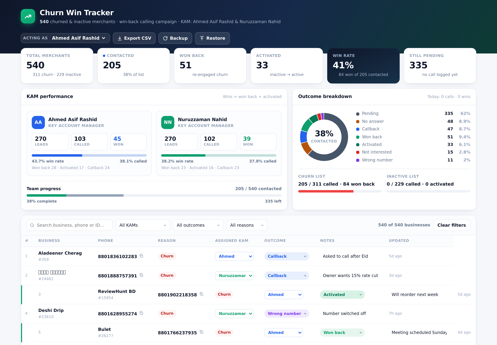

# Churn Win Tracker

Win-back calling dashboard for the **540 churned & inactive merchants** on the
*Churn & Inactive merchant List* sheet. Two KAMs — **Ahmed Asif Rashid** and
**Nuruzzaman Nahid** — work the list, log the outcome of each call, and every
change is **written straight into the Google Sheet**. Both KAMs see one shared board.



*Screenshot uses seeded demo data — a fresh install starts with all 540 pending.*

---

## How the pieces fit

```
┌────────────────┐   POST/GET    ┌──────────────────┐   writes E–H   ┌──────────────┐
│   Dashboard    │ ────────────▶ │  Apps Script     │ ─────────────▶ │ Google Sheet │
│  (Vercel,      │ ◀──────────── │  Web App         │ ◀───────────── │  columns E–H │
│   static page) │   pull rows   │  (inside sheet)  │                │              │
└────────────────┘               └──────────────────┘                └──────────────┘
```

The dashboard is a single static HTML file — no build step, no Node runtime.
A static page cannot safely hold Google credentials, so the sheet writes go
through an **Apps Script Web App** that runs inside your spreadsheet. Nothing
secret is ever shipped to the browser.

👉 **Setup: see [`apps-script/README.md`](apps-script/README.md) — one-time, ~5 minutes.**

---

## What it does

| Area | Detail |
|---|---|
| **KPI strip** | Total merchants, Contacted, Won back, Activated, Win rate, Still pending |
| **KAM board** | Per-KAM leads / called / won, win rate, call-through rate, team progress |
| **Outcome donut** | Live split across the 7 outcomes, plus Churn (311) vs Inactive (229) progress separately |
| **Work list** | 540 merchants, 50/page, click-to-call `tel:` links, one-tap copy, KAM reassignment, outcome dropdown, notes, updated time |
| **Search & filters** | By name (Bengali supported), phone or ID; filter by KAM, outcome, Churn/Inactive |
| **Sheet sync** | Every edit queued → written to columns E–H; pulls the other KAM's edits every 45s |
| **Export** | Filtered CSV, Excel-safe UTF-8 so Bangla names survive |
| **Backup / Restore** | Offline JSON backup; Restore merges newest-wins (works with or without a sheet) |

Outcomes: `Pending` · `No answer` · `Callback` · `Won back` · `Activated` ·
`Not interested` · `Wrong number`.
**Wins** = `Won back` + `Activated`. **Win rate** = wins ÷ merchants contacted.
`Acting as` decides which KAM is credited in the activity log.

---

## Sheet sync behaviour

- Edits are saved to the browser **instantly**, then pushed to the sheet within ~1s
- Sheet unreachable → pill shows **Sync error**, change stays queued and retries
  every 6s until it lands. Nothing is lost, and the local UI never blocks.
- Auto-pull every 45s, and when you return to the tab → the two KAMs converge
- Conflict rule: **newest `Updated` timestamp wins** per merchant (matched by Business ID)
- **Disconnect** stops all writing; local data untouched
- Offline-first: the app is fully usable with sync switched off

Sheet columns: `A` Business ID · `B` Reason · `C` Business Name · `D` Phone ·
**`E` Assigned KAM · `F` Outcome · `G` Notes · `H` Updated**

---

## Run locally

```bash
open index.html          # macOS
xdg-open index.html      # Linux
start index.html         # Windows
```

Or serve it:

```bash
python3 -m http.server 4173   # → http://localhost:4173
```

## Rebuild after changing data or UI

```bash
# 1. edit src/template.html (UI/logic) or src/biz_data.json (merchant data)
python3 build.py             # → regenerates index.html
```

`src/biz_data.json` is `[[businessId, reason, name, phone], …]`.
Refresh it from Hive and re-run `build.py` — nothing else changes.

---

## Push to GitHub

```bash
cd churn-win-tracker
git init && git add . && git commit -m "Churn win tracker with Google Sheet sync"
git branch -M main
# create an empty repo on github.com first, then:
git remote add origin https://github.com/<you>/churn-win-tracker.git
git push -u origin main
```

## Deploy to Vercel

**Option A — dashboard (auto-deploys on every push)**
1. [vercel.com/new](https://vercel.com/new) → **Import Git Repository** → pick the repo
2. Framework preset **Other**, no build command, no output directory
3. **Deploy**

**Option B — CLI**

```bash
npm i -g vercel
cd churn-win-tracker
vercel --prod
```

No environment variables, no database, no build step.

---

## Project structure

```
churn-win-tracker/
├── index.html              # built app — this is what gets deployed
├── src/
│   ├── template.html       # source UI + logic (data placeholder __DATA__)
│   └── biz_data.json       # 540 merchants: [id, reason, name, phone]
├── build.py                # inlines data into template → index.html
├── apps-script/
│   ├── Code.gs             # the web app that writes to the sheet
│   └── README.md           # 5-minute setup guide
├── docs/dashboard.png
├── vercel.json
└── .gitignore
```

---

## Notes & limitations

- Phone numbers are kept exactly as Hive stores them. Two are local format
  (`12348` → `01326882802`, `13089` → `01636090607`); the rest are `8801XXXXXXXXX`.
- Bengali names render with the system Bengali font (`Noto Sans Bengali`,
  `Nirmala UI`, `Vrinda`, `SolaimanLipi`, `Kalpurush` fallbacks).
- The dashboard ships **empty** (all 540 pending). The screenshots are seeded demo data.
- Apps Script web apps have no CORS preflight support, so the client POSTs as
  `text/plain` — deliberate, and verified.
- Sync is last-write-wins on a timestamp. If both KAMs edit the *same* merchant
  within the same second, one note can be overwritten — normal for this scale.
- Each browser keeps a local cache; the sheet remains the shared source of truth.
